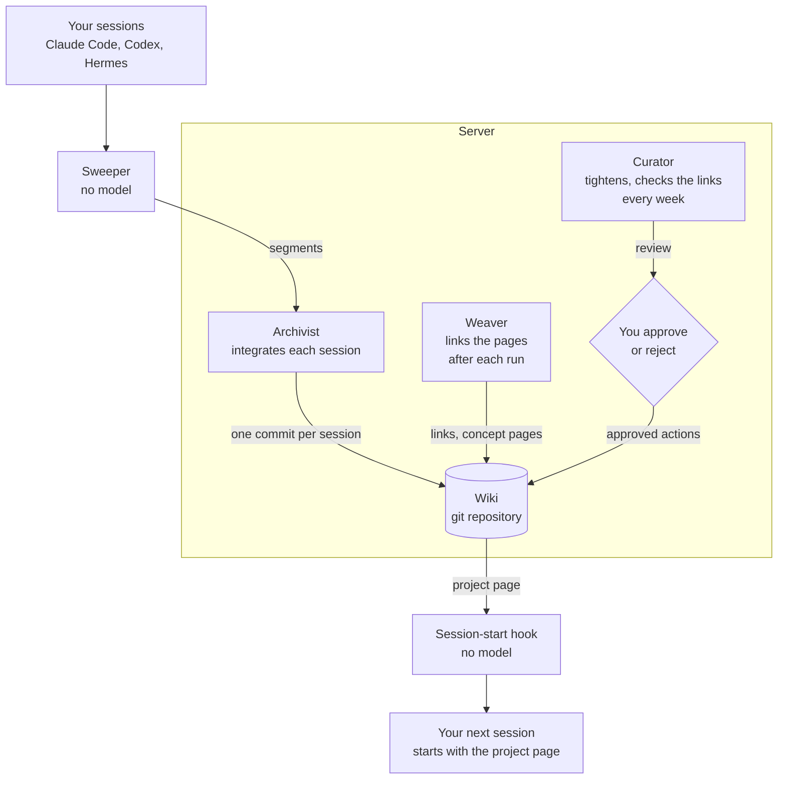

# memex — the role of each agent

Three agent roles maintain the wiki: the **archivist**, the **weaver** and the **curator**. This
page shows who does what. The reasons behind each choice are in
[ARCHITECTURE.md](ARCHITECTURE.md#6-the-three-agents).

## The three roles

| | Archivist | Weaver | Curator |
|---|---|---|---|
| Job | Keeps what a session decided or learned, and files it in the right pages | Links pages that mention each other, writes the pages of cross-cutting concepts | Merges duplicates, condenses long pages, fixes stale content, checks the links |
| Runs | On every session that arrives | After the archivist, when there are leads to follow | Every week (Sunday 05:00 by default) |
| Agent calls | `extract` (no tools, returns JSON), then `integrate` (reads and writes) | `weave` (reads and writes) | `diagnose` (read-only), `links` (read-only, one call per folder), `apply` (reads and writes, one call per action) |
| May | Add pages, complete existing ones, add a decision record | Wrap words in `[[…]]`, add a "See also" section, create pages in `Concepts/`, fix a broken link | Modify, merge, move, delete pages. A `link` action may change links only |
| May not | Delete or rename a page, rewrite an existing decision record (it may only mark it superseded), write in `Concepts/` | Change a word of the text, delete a page, remove or redirect a working link, touch a decision record | Touch a decision record |
| Applied | Directly | Directly | Only after you approve, action by action |
| Prompts | `extract.md`, `integrate.md` | `weave.md` | `curate-diagnose.md`, `curate-links.md`, `curate-apply.md` |

The archivist and the weaver only add, so they run unattended. The curator can remove, so nothing
it proposes reaches the wiki before you answer the review.

## What they have in common

- **A disposable working copy.** An agent writes in a git working copy created for the call, never
  in the wiki itself.
- **Guardrails on the diff.** The code compares what the agent changed with what its role allows
  (the "May" and "May not" rows above). A change out of scope is reverted or fails the call. The
  archivist and the weaver then get one more attempt, with the list of faults; a curator action
  that fails is left out of the review.
- **Reserved files.** `index.md`, `log.md` and `Journal/` are written by the code, and `AGENTS.md`
  by you. An agent's change there is reverted.
- **A sandbox.** When bubblewrap is available, each call runs with the system read-only, apart
  from its working copy and the harness's own state.
- **The same conventions.** Every call that reads or writes the wiki receives the wiki's
  `AGENTS.md`, which you can edit from Obsidian.
- **One writer at a time.** A single lock covers the three roles and your approvals.

## What is not an agent

The model writes pages and nothing else. Everything below is plain code, with no model call:

| Part | What it does |
|---|---|
| Sweeper | On your machine, turns a finished session into a segment (your messages and the agent's final answers) and redacts secrets before anything leaves |
| Triage | A session in which you wrote almost nothing costs no agent call: one line in the journal |
| Bookkeeping | Index, journal, `log.md`, sources and dates in the page headers, commits and merges |
| Check (`memex server lint`) | Broken links, orphan pages, pages over their limit, titles mentioned without a link, concepts shared by several folders. It gives the weaver its leads and the curator its report |
| Session-start hook | Puts the project's page into a new session, with the list of the pages linked with it |
